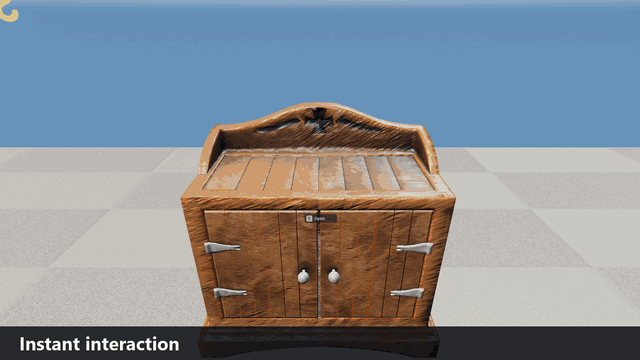

# PromptBeckon

Interaction prompts for Unreal Engine 5.8: instant, hold and mash, on screen or in the world.

## Setup

1. Put the plugin in `Plugins/` and enable it.
2. Pick a trace channel for `DetectChannel` in Project Settings > Plugins > Prompt Beckon.
3. Add `PromptBeckonInteractorComponent` to the player pawn. Call `InteractPressed` and `InteractReleased` from input.
4. On the target actor, pass a sphere or box to `ConfigShape` and attach a `PromptBeckonPointComponent` to it.
   Implement `Prompt Beckon Point Provider` to return the point.
5. Give the point a `PromptBeckonDefinition` asset and bind `OnInteracted`.

## Where to look

| To | Look at |
|---|---|
| Pick instant, hold or mash, the verb, the cooldown, screen or world | [PBDefinition.h](Source/PromptBeckon/Public/Interaction/PBDefinition.h) |
| Tune range, stickiness, line of sight, the scorer | [InteractorComponent.h](Source/PromptBeckon/Public/Interaction/InteractorComponent.h) |
| Write your own focus rule | [FocusScorer.h](Source/PromptBeckon/Public/Interaction/Scorers/FocusScorer.h), see [Reticle](Source/PromptBeckon/Public/Interaction/Scorers/ReticleScorer.h) and [Nearest](Source/PromptBeckon/Public/Interaction/Scorers/NearestScorer.h) |
| Write your own driver | [InteractionDriver.h](Source/PromptBeckon/Public/Interaction/Drivers/InteractionDriver.h), see [Hold](Source/PromptBeckon/Public/Interaction/Drivers/HoldDriver.h) and [Mash](Source/PromptBeckon/Public/Interaction/Drivers/MashDriver.h) |
| Draw your own prompt widget | [PromptWidget.h](Source/PromptBeckon/Public/Interaction/PromptWidget.h), implement `SetPromptState` |
| Refuse a press | [InteractionGate.h](Source/PromptBeckon/Public/Interaction/InteractionGate.h), return false from `CanBegin` |
| Point events: `OnInteracted`, `OnInteractEnd`, `OnStateChanged`, `OnAvailChanged`, `OnFocusChanged` | [PointComponent.h](Source/PromptBeckon/Public/Interaction/PointComponent.h) |
| Player events: `OnFocusChanged`, `OnInteractStart`, `OnInteractEnd` | [InteractorComponent.h](Source/PromptBeckon/Public/Interaction/InteractorComponent.h) |
| Result tags of an ended interaction | [InteractionTags.h](Source/PromptBeckon/Public/Interaction/InteractionTags.h) |
| Blueprint compile checks for points | [BlueprintValidation.h](Source/PromptBeckonEditor/Public/BlueprintValidation.h) |

## Events

**Events wait until the call is done.** `InteractPressed` changes everything first, then sends the events. One press
on an instant point sends `OnInteractStart`, then `OnInteracted`, then `OnInteractEnd`.

**An event tells you what happened then. A getter tells you what is true now.** Inside `OnInteractStart` for an
instant press, `IsInteracting()` is already false: the press is over.

**You cannot stop a press from an event.** Use a gate for that.

**Pressing again inside an event starts a new press.** It waits until the current one sends `OnInteractEnd`.

**Endless loops stop at 32 steps.** An `OnInteracted` that always presses again is one example. At 32 steps the
press is refused and an error is logged. Other event loops get one warning at 32 steps, and all events still go out.
